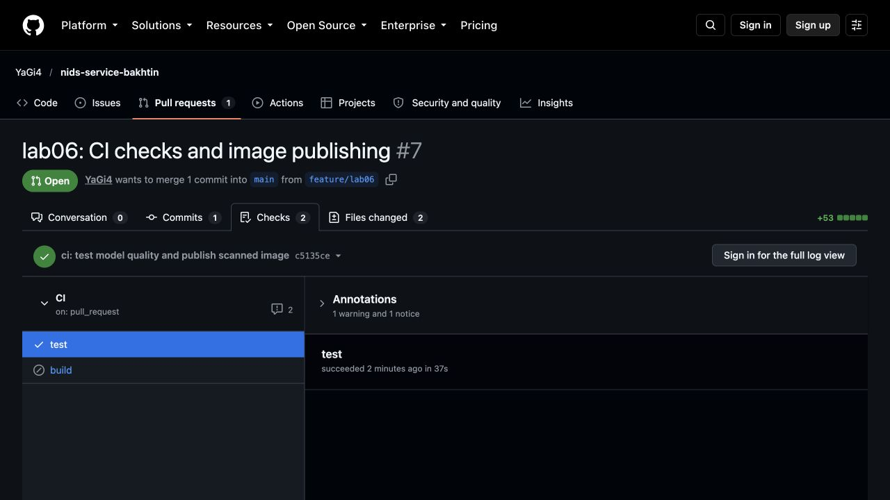
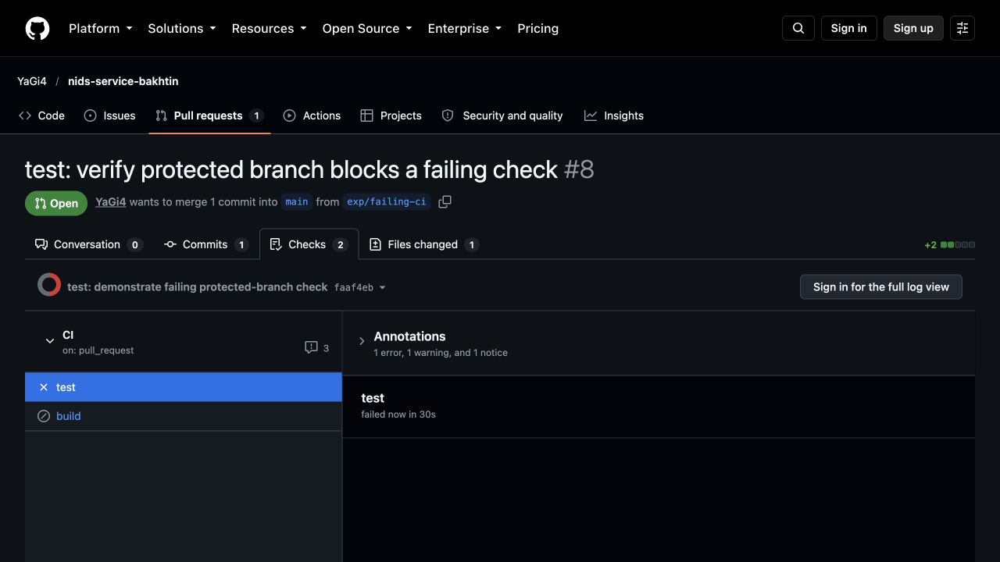
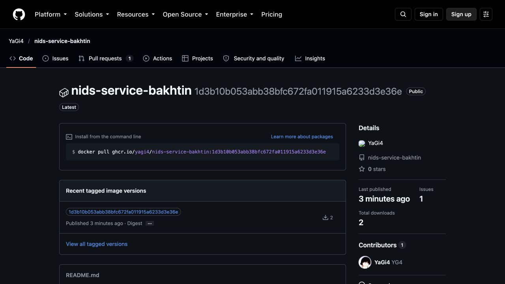

# Лабораторная работа № 6. GitHub Actions

## Цель
Автоматически проверять код и качество модели на каждом изменении, собирать и публиковать образ только после успешных проверок, защищать основную ветку.

## Ход работы
Workflow `.github/workflows/ci.yml` запускает `test` на `push` в `main` и на каждом Pull Request. Job устанавливает Python 3.12, зависимости, выполняет `ruff check .` и `pytest -q`. Кэш pip включён через `actions/setup-python`. Job `build` зависит от `test` через `needs`, собирает образ локально, сканирует его и только после этого публикует в GHCR с тегом полного SHA коммита. Используется временный `secrets.GITHUB_TOKEN` с правом `packages: write`. Первый проход Trivy выводит все HIGH и CRITICAL в журнал; второй завершает job с ошибкой, если уязвимость этих уровней имеет доступное исправление (`ignore-unfixed: true`). Неисправленные уязвимости при этом не считаются устранёнными.

Добавлен тест `tests/test_model_quality.py`: он читает `metadata.json`, полученный при обучении тестовой модели, и требует F1 ≥ 0,85. На исправном коде локально получено:

```text
$ ruff check .
All checks passed!
$ pytest -q
11 passed, 1 warning
```

Одного удаления `serror_rate` оказалось недостаточно: пять выбранных тестов продолжили проходить. Затем временно оставлен только числовой признак `duration`. Результат:

```text
$ pytest -q
2 failed, 9 passed
FAILED tests/test_features.py::test_split_xy_rejects_missing_columns
FAILED tests/test_model_quality.py::test_f1_at_least_085
E assert 0.8329 >= 0.85
```

Контрактные тесты API прошли, поскольку проверяют формат ответа и явный профиль атаки. Тест отсутствующей колонки выявил исчезновение `src_bytes` из списка обязательных признаков. Тест качества обнаружил ухудшение F1. После восстановления `features.py` снова прошли все 11 тестов.

Первый удалённый запуск в [PR № 7](https://github.com/YaGi4/nids-service-bakhtin/pull/7/checks) завершился успешно: job `test` выполнялся 37 с. После добавления отчёта повторный запуск с включённым pip-кэшем занял 31 с. Разница 6 с на этой паре запусков не является чистым измерением эффекта кэша: на время влияет и состояние runner. Job `build` в PR пропущен по условию `if: github.event_name == 'push'`; образ публикуется после слияния в `main`. Для `main` включено правило защиты: слияние только через PR, обязательный статус `test`, проверка актуальности ветки, применение правила к администратору.



Для проверки защиты создан [PR № 8](https://github.com/YaGi4/nids-service-bakhtin/pull/8) с заведомо падающим тестом. GitHub Actions показал ошибку `test`, а API GitHub вернул `mergeable_state=blocked`. Затем тест удалён, повторная проверка прошла и состояние стало `clean`. Это подтвердило, что правило не только показывает красный статус, но и запрещает слияние.



После слияния PR № 7 образ с тегом `1d3b10b053abb38bfc672fa011915a6233d3e36e` опубликован в [GHCR](https://github.com/YaGi4/nids-service-bakhtin/pkgs/container/nids-service-bakhtin). Сканирование выявило 44 HIGH-записи в пакетах базовой Debian 13 и 0 HIGH/CRITICAL в Python-зависимостях; для всех 44 в базе Trivy отсутствовала исправленная версия. Поэтому CI оставляет полный список в журнале и блокирует публикацию при появлении исправляемых HIGH/CRITICAL. Такой выбор не означает, что образ свободен от рисков: базовый образ нужно обновлять по мере появления исправлений.

Первый запуск `build` после PR № 7 завершился ошибкой Trivy из-за этих 44 записей: в первоначальной схеме образ уже был отправлен в реестр до сканирования. Схема скорректирована: сканирование теперь предшествует `docker push`, а неисправляемые находки видны в журнале, но сами по себе не останавливают публикацию. Локальная проверка Trivy с `--ignore-unfixed --severity HIGH,CRITICAL --exit-code 1` нашла 0 записей и завершилась с кодом 0.

Опубликованный образ отдельно загружен командой `docker run` и проверен по `/health` на порту 8001. Ответ: `{"status":"ok","model_loaded":true,"model_version":"0.1.0"}`. Контейнер после проверки остановлен.



## Ответы на контрольные вопросы
1. Чистый runner собирает проект без случайно установленных на машине разработчика пакетов и локальных файлов, подтверждая воспроизводимость.
2. `needs: test` не запускает публикацию до успешных тестов. Без зависимости неисправный код может попасть в реестр.
3. Контрактный тест проверяет поля, типы и коды ответа: изменение модели может законно изменить класс конкретного пограничного примера.
4. Порог F1 ловит деградацию качества при исправном интерфейсе; сокращение списка признаков в эксперименте дало F1 = 0,8329.
5. Порог выбирают по базовым метрикам и цене ошибок. Слишком высокий даёт ложные остановки от малых колебаний, слишком низкий пропускает реальную деградацию.
6. `GITHUB_TOKEN` выдаётся на один запуск и ограничивается правами job; ручной долгоживущий токен требует отдельной выдачи, хранения и отзыва.
7. SHA однозначно связывает образ с коммитом. Тег `latest` перезаписывается, из-за чего невозможно надёжно восстановить исходный код работающего образа.
8. Без защиты ветки красная проверка лишь сообщает об ошибке, но не запрещает слияние или прямой push.

## Возникшие затруднения и устранение
Удаление одного числового признака `serror_rate` не снизило F1 ниже порога: оставшиеся признаки сохраняли достаточную информацию. Для проверки действенности порога временно оставлен только `duration`, получена ожидаемая ошибка, затем полный список восстановлен. Этот эксперимент показывает, что тест реагирует на существенную потерю информации, а не на любое изменение кода. Перед публикацией образа исправлены два потенциальных сбоя: имя репозитория приведено к нижнему регистру для GHCR, а тег Trivy Action указан с префиксом `v`, как в опубликованном релизе.
